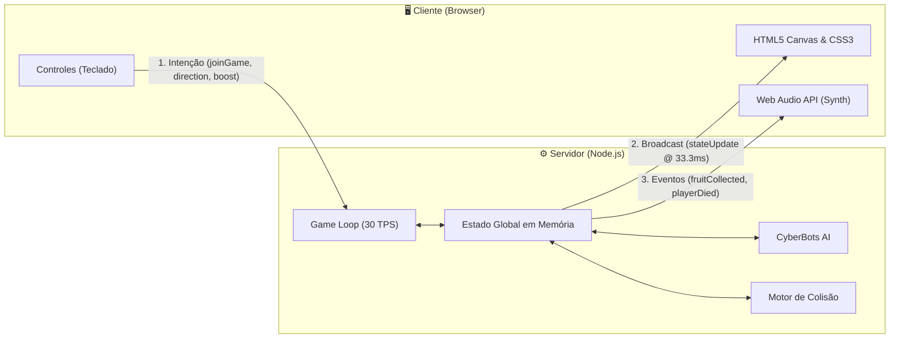

# game_stake


---

## 🚀 1. Visão Geral do Projeto

O **Snake Battle ULTRA** é um jogo de arena multiplayer 2D em tempo real desenvolvido com foco em alta performance, jogabilidade competitiva e baixa latência. O projeto utiliza uma arquitetura **100% Server-Authoritative** (servidor como única fonte da verdade), prevenindo trapaças, manipulação de coordenadas e dessincronização entre múltiplos clientes.

### 🛠️ Stack Tecnológica

* **Back-end:** Node.js, Express (servidor de arquivos estáticos e rotas HTTP), Socket.io (comunicação bidirecional full-duplex sobre WebSockets).
* **Front-end:** HTML5 Canvas 2D nativo, Vanilla JavaScript (ES6+), CSS3 moderno (*Glassmorphism* e *Neon Cyberpunk*).
* **Áudio:** Sintetizador procedural em tempo real com a **Web Audio API** nativa (zero arquivos `.mp3` ou dependências externas).
* **Renderização:** Game Loop desacoplado utilizando `requestAnimationFrame`.

---

## 🔄 2. Diagrama de Arquitetura e Fluxo de Dados




---

## ⚙️ 3. Arquitetura do Servidor (`server.js`)

### 3.1. Estado Centralizado

O servidor mantém em memória o estado absoluto da partida:

* `players = {}`: Dicionário indexado pelo `socket.id` (ou `bot_id`).
* `fruits = []`: Array contendo exatamente 6 frutas distribuídas na arena.
* `powerUps = []`: Array contendo itens especiais temporários ativos no chão.
* `OBSTACLES = []`: Definição geométrica dos 5 obstáculos mortais fixos.
* `PORTALS = []`: Dois portais quânticos pareados para teletransporte.

### 3.2. Detecção Geométrica de Colisões

#### A. Círculo vs. Retângulo (AABB) — Colisão com Obstáculos

Para verificar se a cabeça circular da cobra colidiu com qualquer barreira retangular, calcula-se o ponto do retângulo mais próximo ao centro do círculo:

```javascript
function checkCircleRectCollision(cx, cy, radius, rx, ry, rw, rh) {
  const closestX = Math.max(rx, Math.min(cx, rx + rw));
  const closestY = Math.max(ry, Math.min(cy, ry + rh));
  const dx = cx - closestX;
  const dy = cy - closestY;
  return (dx * dx + dy * dy) < (radius * radius);
}

```

#### B. Círculo vs. Círculo — Colisão com Frutas, Portais e Segmentos Inimigos


```javascript
const dist = Math.hypot(pA.x - seg.x, pA.y - seg.y);
if (dist < HEAD_RADIUS + BODY_RADIUS - 4) {
  // Trata absorção por escudo ou eliminação
}

```

### 3.3. Inteligência Artificial dos CyberBots (`updateBotAI`)

Se houver menos de 3 competidores na arena, bots automatizados entram na partida seguindo 4 etapas:

1. **Percepção:** Localiza o item mais vantajoso (prioriza *power-ups*, depois a fruta mais próxima).
2. **Raycasting / Simulação de Movimento:** Avalia as direções candidatas projetando a posição da cabeça `45 pixels` à frente.
3. **Evasão:** Descarta rotas que cruzem com bordas externas, barreiras ou corpos de outras cobras.
4. **Decisão:** Seleciona a direção segura com menor distância vetorial ao alvo.

---

## 🎨 4. Arquitetura do Cliente (`public/`)

### 4.1. Interface e Estrutura (`index.html` e `style.css`)

* **Modal Glassmorphism Inicial:** Permite escolher nome e selecionar uma de 8 cores vibrantes com preview imediato.
* **Top Bar (HUD de Telemetria):**
* Pontuação, Comprimento da Cobra e Contagem de Kills.
* Medidor de Latência em tempo real via Ping/Pong com o servidor (`Date.now() - clientTime`).
* Medidor de FPS baseado na variação de quadros por segundo (`performance.now()`).
* Indicadores dinâmicos de buffs ativos (🛡️ Escudo, 🧲 Ímã, 👻 Fantasma, ⚡ Raio).


* **Canvas Central Responsivo (`800×600`):** Isolado em um wrapper com classe `.shake` acionada por animação CSS em momentos de explosão.

### 4.2. Sintetizador Web Audio API (`SoundFX`)

Gera 100% dos efeitos sonoros e música de fundo via código, eliminando requisições HTTP de arquivos de mídia:

| Efeito Sonoro | Síntese e Frequência |
| --- | --- |
| **Música Synthwave** | Loop rítmico a cada `240ms` utilizando oscilador *sawtooth* conectado a um filtro passa-baixas (`BiquadFilterNode` de `400Hz`), gerando uma linha de baixo eletrônica relaxante. |
| **Comer Fruta** | Oscilador de frequência senoidal ascendente ($440\text{Hz} \to 660\text{Hz} \to 880\text{Hz}$). |
| **Teletransporte** | Glissando de frequência senoidal ($300\text{Hz} \to 900\text{Hz}$). |
| **Quebra de Escudo** | Oscilador *sawtooth* com queda súbita ($700\text{Hz} \to 150\text{Hz}$). |
| **Eliminação** | Onda ruidosa grave com envelope de ganho exponencial. |

### 4.3. Loop de Renderização no Canvas (`render()`)

Executado a **60 FPS** com `requestAnimationFrame`:

1. `ctx.clearRect()`: Limpeza completa do quadro anterior.
2. `drawGrid()`: Linhas de coordenadas estilo *Tron* e borda energizada da arena.
3. `drawPortals()`: Vórtices com arcos polares giratórios e anéis em direções alternadas.
4. `drawObstacles()`: Retângulos de aviso com faixas diagonais dinâmicas (*hazard stripes*) e bordas neon pulsantes.
5. `drawPowerUps()`: Círculos flutuantes com sombras e ícones característicos.
6. `fruits.forEach()`: Frutas pulsando de acordo com função senoidal no tempo (`Math.sin(time + x)`).
7. `drawSnakes()`:
* Segmentos da cauda com gradiente decrescente de espessura.
* Cabeça com brilho neon e olhos que se ajustam dinamicamente na direção do movimento.
* Animação da língua bifurcada oscilante.
* Aura circular giratória quando o escudo estiver ativo e opacidade reduzida em modo fantasma.


8. `updateParticles()`: Atualização da cinemática das partículas de explosão.
9. `updateLeaderboard()`: Atualização e ordenação decrescente do placar com medalhas 🥇, 🥈, 🥉.

---

## 📡 5. Dicionário de Comunicação Socket.io

| Evento | Origem | Destino | Payload | Descrição |
| --- | --- | --- | --- | --- |
| `joinGame` | Cliente | Servidor | `{ name, color }` | Solicita entrada na partida com personalização. |
| `init` | Servidor | Cliente | `{ id, players, fruits, obstacles, portals }` | Entrega do estado global ao socket recém-conectado. |
| `newPlayer` | Servidor | Outros | `player` | Anuncia novo jogador conectado para os outros sockets. |
| `playerChangeDirection` | Cliente | Servidor | `'up' | 'down' | 'left' | 'right'` | Intenção de virada (servidor valida anti-180°). |
| `playerBoost` | Cliente | Servidor | `boolean` | Ativação/desativação do turbo com a barra de espaço. |
| `stateUpdate` | Servidor | Todos | `{ players, fruits, powerUps }` | Broadcast do estado consolidado a cada `33.3ms` (30 FPS). |
| `fruitCollected` | Servidor | Todos | `{ fruitId, x, y, color, value, playerId }` | Dispara efeitos visuais e sonoros de fruta coletada. |
| `powerUpCollected` | Servidor | Todos | `{ playerId, type, x, y, color, label }` | Dispara efeito sonoro e notificação de buff ativado. |
| `shieldAbsorb` | Servidor | Todos | `{ x, y, playerId }` | Dispara tremor de tela e efeito sonoro de absorção de dano. |
| `portalWarp` | Servidor | Todos | `{ x, y, color, playerId }` | Efeito sonoro e partículas de teletransporte. |
| `playerDied` | Servidor | Todos | `{ id, killerName }` | Dispara partículas de destruição e tela de respawn. |
| `gameNotice` | Servidor | Todos | `{ text, type }` | Exibe notificação flutuante no feed superior da tela. |
| `latencyPing` / `latencyPong` | Ambos | Ambos | `timestamp` | Cálculo bidirecional do Ping em milissegundos. |

---

## 💻 6. Como Executar Localmente

1. **Instalação das dependências:**
```bash
cd c:\Users\mabf.gago\Desktop\jogo
npm install

```


2. **Inicialização do Servidor:**
```bash
npm start

```


3. **Acesso no Navegador:**
Abra [http://localhost:3000](http://localhost:3000) e comece a jogar!

```

```
